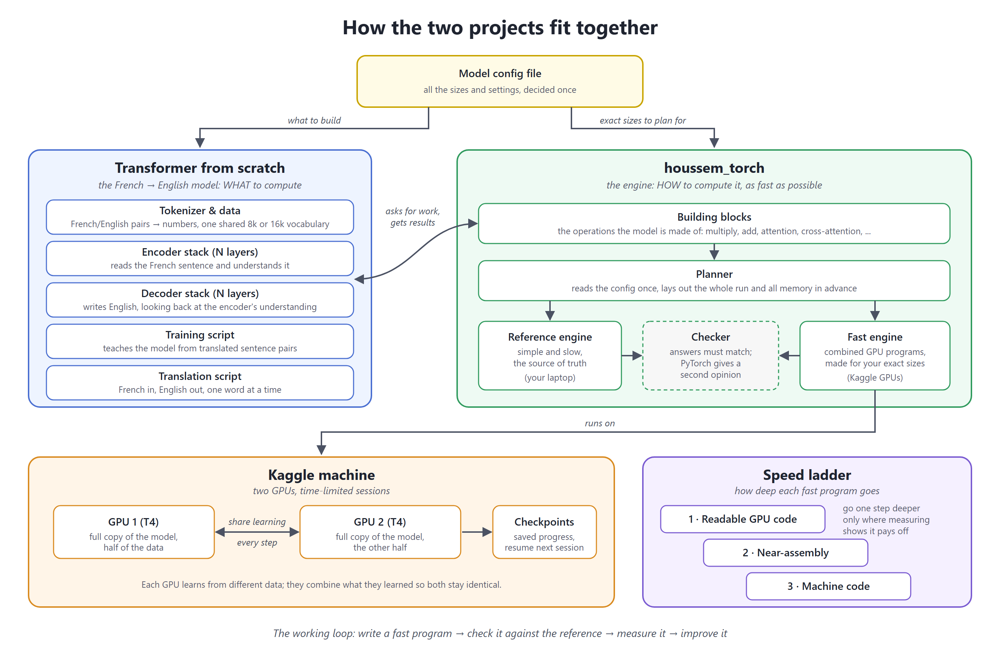

# The big picture

The diagram's source is [`images/big_picture.svg`](images/big_picture.svg).
Edit it, then re-export the PNG.

## The goal

Train and run **one specific transformer**, built from scratch, as fast as
the hardware allows. The transformer **translates French into English**.

General-purpose libraries like PyTorch are built to run any model, of any
size, on any machine. To do that, they spend time at every step working out
what they've been asked to do. This project doesn't need that flexibility.
It needs to run exactly one model, with sizes known in advance, on known
hardware. Every bit of generality removed is time handed back to the actual
work.

## Two projects, two jobs

| | Transformer from scratch | houssem_torch |
|---|---|---|
| Role | The **model** | The **engine** |
| Answers | *What* should be computed? | *How* do we compute it as fast as possible? |
| Contains | Tokenizer and data, the encoder and decoder stacks, the training script, the translation script | The building blocks the model is made of, a planner, a reference engine, a fast engine, and a checker |

The model never cares how the engine does its job. It asks for work (multiply
these, apply attention to that) and gets results back. That separation is
what makes the speed work possible: the engine can be rewritten again and
again, getting faster each time, without touching the model.

## The translation model

The model is the complete original transformer, made of two halves:

- **The encoder reads the French sentence.** It is a stack of identical
  layers, each refining its understanding of the whole sentence. Every
  French word can look at every other French word.
- **The decoder writes the English sentence.** It is also a stack of identical
  layers. Each English word can look at the English words before it, and also
  looks back at the encoder's understanding of the French. That look-back is
  how the translation stays faithful to the original.

French and English share one vocabulary of **8,000 or 16,000** word pieces.

Two habits of translation shape the engine:

- **Sentences come in different lengths.** Sentences of similar length are
  grouped together into a few fixed sizes, so the engine can still plan
  everything in advance and wastes little work on padding.
- **English is written one word at a time.** The French sentence only needs
  to be read once; after that, the decoder repeats a small amount of work
  for every English word, reusing what it has already worked out.

Every stage of the model, with the exact shape of the data flowing through
it, is mapped out in [Stages, operations and shapes](transformer_shapes.md).

## The config file: decide once, never ask again

All of the model's sizes and settings live in one config file. Both projects
read it:

- **The transformer** reads it to know *what to build*: how many encoder and
  decoder layers, how wide, how big the vocabulary is, and which sentence
  lengths to expect.
- **houssem_torch** reads it to know *exact sizes to plan for*.

Because the sizes never change while the model runs, the engine does all of
its thinking once, at startup. It lays out the whole run and every piece of
memory ahead of time. During training there's no guessing, no checking and
no searching for space. The engine just executes the plan.

## Two engines and a checker

Inside houssem_torch there are two ways of computing the same thing:

- **The reference engine** is simple, slow and easy to read. It runs on your
  laptop. Its only job is to be **correct**. It is the source of truth.
- **The fast engine** is made of GPU programs written specifically for your
  model's exact sizes. Its only job is to be **fast**.

**The checker** sits between them. Every fast program has to give the same
answers as the reference engine before it's trusted, and PyTorch serves as
an independent second opinion. Speed never comes at the cost of wrong
results.

## Where the speed comes from: fewer trips

A GPU has a small, very fast workspace right next to its calculators, and a
large but comparatively slow main memory. Most of the time in a transformer
isn't spent calculating. It's spent carrying data back and forth between
the two.

Think of cooking with the pantry in another room. The slow way is to fetch
one ingredient, use it, put the result back in the pantry, then fetch the
next. The fast way is to bring everything you need in one trip and do every
step at the counter.

That is the core idea of this project, called **kernel fusion**: combine
several steps into one GPU program, so data makes one trip instead of many.
The T4 GPUs used here have a comparatively narrow path to their memory,
which makes fewer trips worth even more. Translating word by word is where
this matters most: each step does little calculating and a lot of carrying.

## The speed ladder

Each fast program can be written at three levels of depth:

1. **Readable GPU code.** Where every program starts. It gets most of the
   speed.
2. **Near-assembly.** Finer control over exactly how the GPU moves data.
3. **Machine code.** Full manual control of the hardware's own instructions.

Going deeper gives more control but takes much more effort. The rule is to
**go one step deeper only where measuring shows it pays off**, and in
practice that means only for the one or two programs where most of the time
goes.

## The hardware: two GPUs on Kaggle

Training runs on a Kaggle machine with **two T4 GPUs**:

- Each GPU holds a **full copy of the model** and learns from **a different
  half of the data**.
- After every step they **share what they learned**, so both copies stay
  identical. Two GPUs means roughly twice the learning per step.
- Kaggle sessions are time-limited, so progress is regularly saved as
  **checkpoints**. The next session picks up where the last one stopped.

Day-to-day work splits naturally: the reference engine and correctness work
happen on your laptop, while the fast engine is built, checked and measured
on Kaggle.

## The working loop

Every speed improvement goes through the same four steps:

1. **Write** a fast program.
2. **Check** it against the reference engine.
3. **Measure** how much time it actually saves.
4. **Improve** it, going down the speed ladder only if measuring says it's
   worth it.

## Is it doable?

Yes. It's a long project, measured in months rather than weeks, but each
stage pays off on its own: every new fast program makes training and
translation measurably quicker, and the reference engine guarantees that
nothing breaks along the way.

## What's next

1. Finish the transformer config: the number of layers, the widths, 8k or
   16k vocabulary, and the sentence length groups. Its sizes decide how every
   fast program is shaped.
2. Turn this picture into a staged plan: which building blocks to make fast
   first, and in what order.
