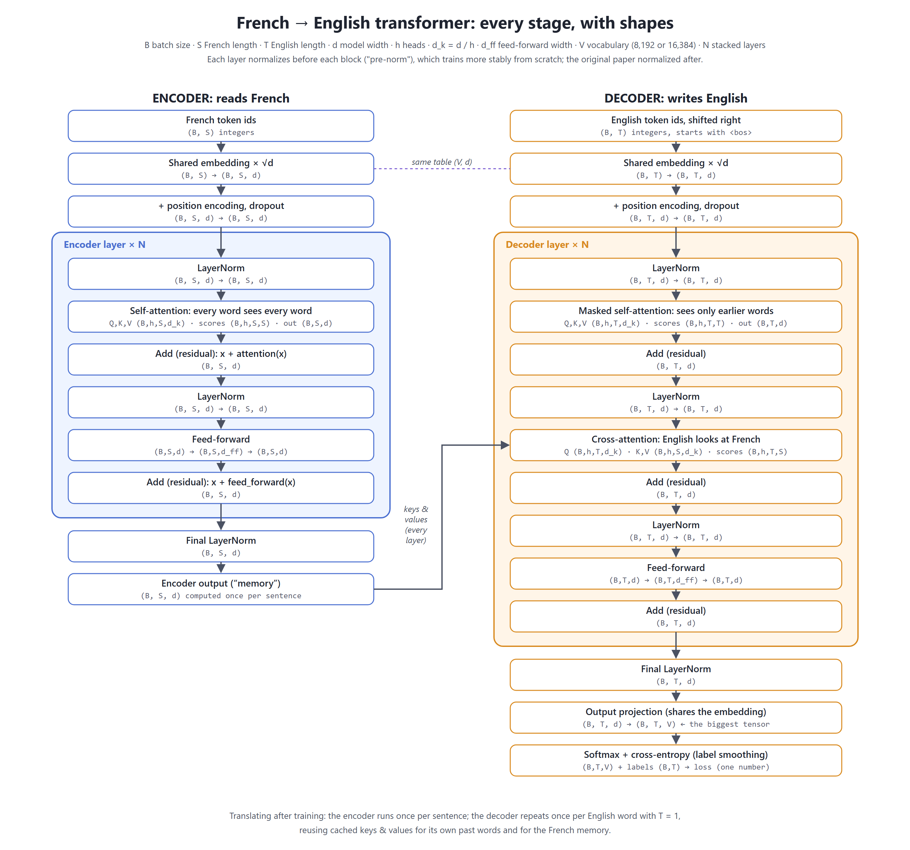

# French → English transformer: stages, operations and shapes

The full encoder-decoder transformer, with N encoder layers and N decoder
layers stacked. This page lists every operation in order, with its input and
output shapes. It's the map of what houssem_torch has to compute.

## Symbols

| Symbol | Meaning | Example (Transformer-base) |
|---|---|---|
| `B` | sentences per batch | 64 |
| `S` | French (source) length in tokens | 64 |
| `T` | English (target) length in tokens | 64 |
| `d` | model width (`d_model`) | 512 |
| `h` | attention heads | 8 |
| `d_k` | width per head = `d / h` | 64 |
| `d_ff` | feed-forward hidden width | 2048 |
| `V` | shared French+English vocabulary | **8,192 or 16,384** |
| `N` | stacked layers (encoder and decoder each) | 6 |

The example column uses the original paper's "base" sizes, just to give the
numbers below a scale. Your config will set the real values.

Conventions:
- A weight matrix `W` of shape `(in, out)` is applied as `x @ W`.
- "Pre-norm" layout: each block normalizes its input first. It trains more
  stably from scratch than the original paper's "post-norm"; this can be a
  config switch.

---

## Stage 0: Inputs (prepared by the data pipeline)

| Tensor | Shape | Contents |
|---|---|---|
| `src_ids` | `(B, S)` int | French token ids, padded to `S` |
| `tgt_in` | `(B, T)` int | English ids **shifted right**: `<bos> w1 w2 …` |
| `tgt_out` | `(B, T)` int | English ids, the labels: `w1 w2 … <eos>` |
| `src_pad` | `(B, S)` bool | true where `src_ids` is padding |
| `tgt_pad` | `(B, T)` bool | true where `tgt_out` is padding |

Sentences are grouped into a few **length buckets** (for example `S, T` ∈
{32, 64, 128}) so little work is wasted on padding. Each bucket is planned
once at startup.

## Stage 1: Encoder input

| # | Operation | Input → Output |
|---|---|---|
| 1.1 | Embedding lookup in the shared table `E (V, d)` | `(B, S)` → `(B, S, d)` |
| 1.2 | Scale by `√d` | `(B, S, d)` → `(B, S, d)` |
| 1.3 | Add sinusoidal position encoding `P (S, d)` (broadcast over `B`) | `(B, S, d)` → `(B, S, d)` |
| 1.4 | Dropout | `(B, S, d)` → `(B, S, d)` |

## Stage 2: Encoder layer (repeated N times)

Input and output are both `x: (B, S, d)`.

**Self-attention block.** Every French token attends to every French token.

| # | Operation | Input → Output |
|---|---|---|
| 2.1 | LayerNorm (weights `γ, β: (d,)`) | `(B, S, d)` → `(B, S, d)` |
| 2.2 | Q, K, V projection, one fused matmul with `W_qkv (d, 3d)` | `(B, S, d)` → `(B, S, 3d)` |
| 2.3 | Split into Q, K, V and into heads (reshape + swap axes) | `(B, S, 3d)` → 3 × `(B, h, S, d_k)` |
| 2.4 | Scores `Q @ Kᵀ / √d_k` | `(B, h, S, d_k) @ (B, h, d_k, S)` → `(B, h, S, S)` |
| 2.5 | Mask French padding (`src_pad` as `(B, 1, 1, S)`) | `(B, h, S, S)` → `(B, h, S, S)` |
| 2.6 | Softmax over the last axis, then dropout | `(B, h, S, S)` → `(B, h, S, S)` |
| 2.7 | Weighted sum `probs @ V` | `(B, h, S, S) @ (B, h, S, d_k)` → `(B, h, S, d_k)` |
| 2.8 | Merge heads (swap axes + reshape) | `(B, h, S, d_k)` → `(B, S, d)` |
| 2.9 | Output projection `W_o (d, d)`, then dropout | `(B, S, d)` → `(B, S, d)` |
| 2.10 | Residual add `x + …` | `(B, S, d)` → `(B, S, d)` |

**Feed-forward block.**

| # | Operation | Input → Output |
|---|---|---|
| 2.11 | LayerNorm | `(B, S, d)` → `(B, S, d)` |
| 2.12 | Up projection `W_1 (d, d_ff)` + bias | `(B, S, d)` → `(B, S, d_ff)` |
| 2.13 | Activation (ReLU in the paper, GELU is common), then dropout | `(B, S, d_ff)` → `(B, S, d_ff)` |
| 2.14 | Down projection `W_2 (d_ff, d)` + bias, then dropout | `(B, S, d_ff)` → `(B, S, d)` |
| 2.15 | Residual add | `(B, S, d)` → `(B, S, d)` |

## Stage 3: Encoder output

| # | Operation | Input → Output |
|---|---|---|
| 3.1 | Final LayerNorm, giving the **memory** | `(B, S, d)` → `(B, S, d)` |

The memory is computed **once per sentence**. Every decoder layer reads it.

## Stage 4: Decoder input

The same as Stage 1, applied to `tgt_in`, using the **same** embedding table
`E`:

| # | Operation | Input → Output |
|---|---|---|
| 4.1–4.4 | Embedding, `× √d`, + position encoding `(T, d)`, dropout | `(B, T)` → `(B, T, d)` |

## Stage 5: Decoder layer (repeated N times)

Input and output are both `y: (B, T, d)`. The layer also reads `memory: (B, S, d)`.

**Masked self-attention block.** Each English token sees only itself and
earlier tokens.

| # | Operation | Input → Output |
|---|---|---|
| 5.1 | LayerNorm | `(B, T, d)` → `(B, T, d)` |
| 5.2 | Q, K, V projection `W_qkv (d, 3d)` | `(B, T, d)` → `(B, T, 3d)` |
| 5.3 | Split into heads | `(B, T, 3d)` → 3 × `(B, h, T, d_k)` |
| 5.4 | Scores `Q @ Kᵀ / √d_k` | → `(B, h, T, T)` |
| 5.5 | Causal mask `(T, T)` + English padding mask `(B, 1, 1, T)` | `(B, h, T, T)` → `(B, h, T, T)` |
| 5.6 | Softmax, then dropout | `(B, h, T, T)` → `(B, h, T, T)` |
| 5.7 | `probs @ V` | → `(B, h, T, d_k)` |
| 5.8 | Merge heads, `W_o (d, d)`, dropout | → `(B, T, d)` |
| 5.9 | Residual add | `(B, T, d)` → `(B, T, d)` |

**Cross-attention block.** English queries look at the French memory. This is
the only place where the two lengths meet.

| # | Operation | Input → Output |
|---|---|---|
| 5.10 | LayerNorm (applied to the decoder stream only) | `(B, T, d)` → `(B, T, d)` |
| 5.11 | Q from the decoder: `W_q (d, d)`, split into heads | `(B, T, d)` → `(B, h, T, d_k)` |
| 5.12 | K, V from the **memory**: `W_kv (d, 2d)`, split into heads | `(B, S, d)` → 2 × `(B, h, S, d_k)` |
| 5.13 | Scores `Q @ Kᵀ / √d_k` | `(B, h, T, d_k) @ (B, h, d_k, S)` → `(B, h, T, S)` |
| 5.14 | Mask French padding `(B, 1, 1, S)` | `(B, h, T, S)` → `(B, h, T, S)` |
| 5.15 | Softmax, then dropout | `(B, h, T, S)` → `(B, h, T, S)` |
| 5.16 | `probs @ V` | `(B, h, T, S) @ (B, h, S, d_k)` → `(B, h, T, d_k)` |
| 5.17 | Merge heads, `W_o (d, d)`, dropout | → `(B, T, d)` |
| 5.18 | Residual add | `(B, T, d)` → `(B, T, d)` |

**Feed-forward block.** The same as 2.11–2.15, with `T` in place of `S`.

| # | Operation | Input → Output |
|---|---|---|
| 5.19–5.23 | LayerNorm, `W_1`, activation, `W_2`, residual add | `(B, T, d)` → `(B, T, d_ff)` → `(B, T, d)` |

## Stage 6: Output and loss

| # | Operation | Input → Output |
|---|---|---|
| 6.1 | Final LayerNorm | `(B, T, d)` → `(B, T, d)` |
| 6.2 | Output projection `@ Eᵀ` (tied to the embedding) | `(B, T, d)` → `(B, T, V)` |
| 6.3 | Log-softmax over `V` | `(B, T, V)` → `(B, T, V)` |
| 6.4 | Cross-entropy against `tgt_out`, with label smoothing; padding ignored | `(B, T, V)` + `(B, T)` → scalar |

## Stage 7: Backward pass and update

The backward pass visits the same operations in reverse. Every gradient has
**exactly the shape of the tensor it belongs to**. Two places are special:

- **The shared embedding `E` collects gradients from three uses:** encoder
  input, decoder input and output projection. Its gradient is their sum,
  shape `(V, d)`.
- **The memory collects gradients from all N decoder layers'** cross-attention
  K/V projections, summed, shape `(B, S, d)`.

Then the optimizer updates every parameter in place, using gradients of the
same shape.

---

## Translating (inference)

Training processes the whole English sentence at once (teacher forcing).
Translating has to produce it one token at a time. With beam size `k`:

| Step | Operation | Shapes |
|---|---|---|
| Once | Encoder (Stages 1–3) | `(B, S)` → memory `(B, S, d)` |
| Once | Repeat the memory for each beam | `(B, S, d)` → `(B·k, S, d)` |
| Once | Cross-attention K, V for every decoder layer, **cached** | N × 2 × `(B·k, h, S, d_k)` |
| Per token `t` | Embed the newest token | `(B·k, 1)` → `(B·k, 1, d)` |
| Per token `t` | Self-attention: append the new K, V to the cache, attend over `t` past tokens | cache `(B·k, h, t, d_k)`, scores `(B·k, h, 1, t)` |
| Per token `t` | Cross-attention over the cached French K, V | scores `(B·k, h, 1, S)` |
| Per token `t` | Feed-forward | `(B·k, 1, d)` → `(B·k, 1, d_ff)` → `(B·k, 1, d)` |
| Per token `t` | Logits and log-softmax | `(B·k, 1, d)` → `(B·k, 1, V)` |
| Per token `t` | Beam search keeps the best `k` continuations per sentence | `(B, k·V)` → `(B, k)` |

Each step does very little arithmetic and a lot of reading from memory. That
makes the translation loop the place where fusing operations pays off most
on the T4.

---

## Sizes at Transformer-base scale

**Parameters** (biases and LayerNorm weights are tiny and left out):

| Part | Formula | Count |
|---|---|---|
| Shared embedding | `V · d` | 4.2 M (8k) / 8.4 M (16k) |
| One encoder layer | `4d² + 2·d·d_ff` | 3.1 M |
| One decoder layer | `8d² + 2·d·d_ff` | 4.2 M |
| **Total, N = 6** | | **≈ 48 M (8k) / ≈ 53 M (16k)** |

That fits easily in a T4's 16 GB, even with optimizer state and fp32 master
weights.

**Largest activations** for one batch (`B = 64`, `S = T = 64`, in fp16):

| Tensor | Shape | Elements | Size |
|---|---|---:|---:|
| Hidden state | `(B, T, d)` | 2.1 M | 4 MB |
| Feed-forward hidden | `(B, T, d_ff)` | 8.4 M | 16 MB |
| Attention scores, one layer | `(B, h, T, T)` | 2.1 M | 4 MB |
| **Logits** | `(B, T, V)` | 33.6 M (8k) / 67.1 M (16k) | **64 MB / 128 MB** |

The logits are by far the largest tensor: 16× (8k) to 32× (16k) a hidden
state. Attention scores grow with the **square** of the length; at
`S = T = 128` they are 4× larger.

## Where fusion helps most

The candidates, in the order of the stages above:

1. **Output projection + log-softmax + loss (6.2–6.4).** Never write out the
   full `(B, T, V)` table. This is the biggest memory saving, and it grows
   with the vocabulary.
2. **Attention (2.4–2.7, 5.4–5.7, 5.13–5.16).** Scores, mask, softmax and
   `@ V` in one program, without storing the scores. One program with three
   switches: no mask (encoder), causal (decoder) and cross (two lengths).
3. **LayerNorm, and residual add + dropout + LayerNorm.** Each block boundary
   reads and writes the hidden state several times; fused, it does so once.
4. **Feed-forward epilogue (2.12–2.13).** Bias and activation applied inside
   the up-projection matmul, before its result is written out.
5. **The translation step.** All of the above, specialized for one token at a
   time.
