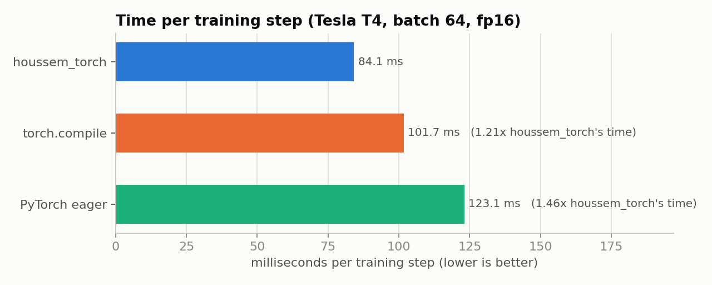
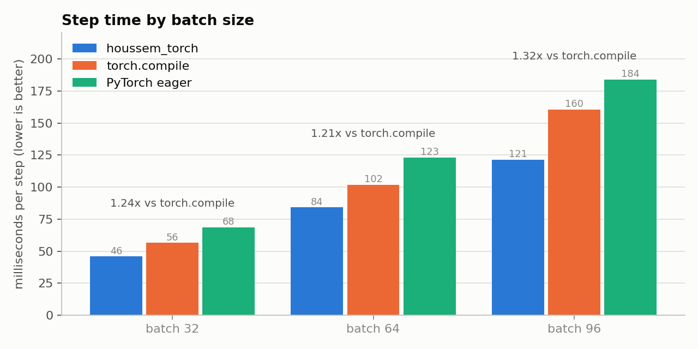
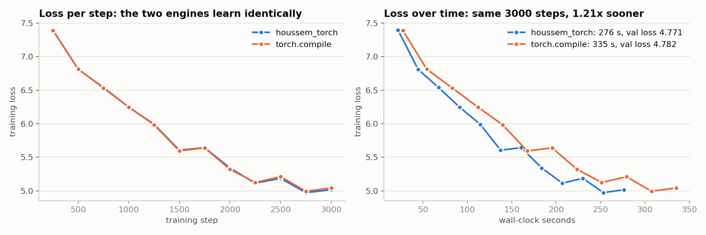
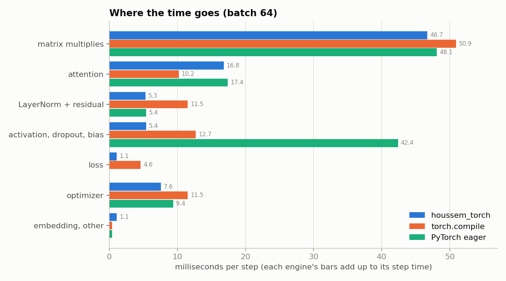
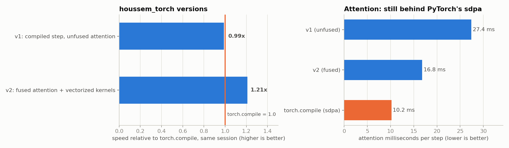

# houssem_torch's GPU training step vs PyTorch on a Tesla T4

*Report of 2026-11-24. Branch `gpu/driver-layer`, final measured commit `839ffd6`.*

## Summary

houssem_torch now trains its encoder-decoder Transformer on an NVIDIA T4
**1.21–1.32× faster than `torch.compile`** and 1.46× faster than eager
PyTorch, on the same model, the same data and the same starting weights, with
**identical learning curves**.

| | houssem_torch | `torch.compile` | PyTorch eager |
|---|---:|---:|---:|
| time per training step (batch 64) | **84.1 ms** | 101.7 ms | 123.1 ms |
| speed relative to houssem_torch | 1.00× | 0.83× | 0.68× |
| 3000 training steps, wall clock | **276 s** | 335 s | — |
| validation loss after 3000 steps | 4.771 | 4.782 | — |
| startup (build / compile) | **0.5 s** | 34.5 s | 0.2 s |
| GPU memory | **2.03 GB** | 2.19 GB | 2.68 GB |



The engine is written from scratch: no PyTorch at runtime. It uses NVIDIA's
cuBLAS for plain matrix multiplies and its own CUDA kernels for everything
else, compiled when the run starts for the exact model and batch shape.

---

## 1. What was built

### 1.1 The idea: compile the whole training step at startup

PyTorch runs a model one operation at a time ("eager"), or, with
`torch.compile`, traces it and generates fused kernels with Inductor/Triton.
houssem_torch takes a third route: **the model config and batch shape are
fixed when the run starts, so the entire training step (forward, backward and
optimizer) is planned and compiled once for exactly those sizes.**

```python
model = Transformer(cfg)                                  # weights + config
step = TrainStep(model, batch_size=64, src_len=64, tgt_len=64)   # ~0.5 s
for src, tgt_in, tgt_out in batches:
    step(src, tgt_in, tgt_out, lr=schedule(i))            # forward + backward + AdamW
```

What "specialized at startup" buys:

- **Memory planned once.** Every buffer is allocated at startup. All 52.5M
  parameters live in one flat fp32 buffer (master weights) plus an fp16
  working copy; gradients and AdamW moments are flat buffers too, so zeroing
  gradients, the gradient norm and the optimizer update are one GPU launch
  each.
- **Kernels compiled for the exact sizes.** Model width, sequence lengths,
  activation and masking are compile-time constants, so the compiler unrolls
  loops and sizes on-chip memory exactly.
- **A fixed launch order** of cuBLAS multiplies and fused kernels, with the
  backward pass written by hand per layer.

### 1.2 Components

| layer | what it does |
|---|---|
| `backends/cuda/driver.py` | thin GPU layer: device memory, streams, timers, NVRTC compilation of our kernels, row-major cuBLAS matrix multiplies, a launch profiler. CuPy is used only as bindings, kept inside this one file. |
| `backends/cuda/kernels.cu` | our CUDA kernels (below) |
| `backends/cuda/train_step.py` | the compiled training step: memory plan, launch order, forward, backward, optimizer |

Fused kernels (each replaces several separate PyTorch operations):

| kernel | fuses |
|---|---|
| embedding + LayerNorm | token lookup, ×√d, positional encoding, dropout, LayerNorm |
| residual + LayerNorm (fwd) | bias add, dropout, residual add, LayerNorm |
| LayerNorm backward | LayerNorm gradient, residual gradient, the previous dropout's gradient, and the previous layer's bias gradient |
| bias + activation | FFN bias, ReLU/GELU, dropout (forward); and their gradients plus the bias gradient (backward) |
| **fused attention** (fwd, bwd) | QKᵀ, scaling, padding/causal masks, softmax, dropout, ×V, and the full backward including the Q/K/V bias gradients, on Turing tensor cores |
| cross-entropy | label-smoothed loss and its gradient in one pass over the logits |
| optimizer | gradient norm, overflow check, loss-scale update, clipping and AdamW for all parameters |

Two design choices worth noting:

- **Dropout masks are never stored.** Whether element *i* is dropped is a hash
  of (seed, *i*), so the backward pass regenerates exactly the forward's mask.
- **Mixed precision without host round trips.** Activations are fp16,
  statistics and gradient sums fp32, master weights fp32. Dynamic loss
  scaling (overflow detection, skipping, scale growth) is decided on the GPU,
  so the CPU never waits for the GPU during training.

### 1.3 The fused attention kernel

One GPU thread block per (sentence, head). It reads Q, K and V directly from
the projection output (adding the bias on load), keeps the 64 × 64 scores and
probabilities in registers, uses Turing's fp16 tensor-core instruction
(`mma.sync.m16n8k8`, written as inline PTX), and writes the result back in
the layout the next matrix multiply expects. Nothing of size length × length
is written to memory; the backward pass recomputes the probabilities from two
saved numbers per row (the row maximum and the log of the sum of
exponentials).

---

## 2. Correctness

Speed only matters if the engine computes the same thing. Checked at four levels:

1. **Against the CPU reference implementation** (`tests/test_cuda_train_step.py`):
   in fp32 the GPU step reproduces houssem_torch's CPU Transformer exactly up
   to float rounding: the loss, every one of the parameter gradients, and
   three AdamW updates, for several configurations (with/without attention
   bias, ReLU/GELU, two label-smoothing modes, padding-index embedding).
   With dropout on, its gradients match finite differences of its own loss.
2. **The attention kernels against a NumPy reference**
   (`tests/test_cuda_attention.py`) that reproduces the dropout hash bit for
   bit: padding, causal masking, cross-attention with different lengths,
   lengths that aren't multiples of 16, a sentence made only of padding, and
   the bias gradients.
3. **Against PyTorch:** loaded with the same weights, both engines give the
   same loss on a real batch (houssem_torch fp16 **10.32006**, PyTorch fp32
   10.31998, PyTorch fp16 10.32001).
4. **Training:** over 3000 steps on the same batches the two loss curves
   overlap (figure 4, left).

All 32 GPU tests pass on the T4; the full suite (CPU + GPU) has 282 tests.

---

## 3. Experimental setup

| | |
|---|---|
| hardware | Kaggle, 2 × NVIDIA Tesla T4 (Turing, sm_75, 40 SMs, 16 GB); houssem_torch on GPU 0, PyTorch on GPU 1 |
| software | PyTorch 2.11.0 (CUDA 13.0); houssem_torch with CuPy 14 (CUDA 12 libraries) |
| model | encoder-decoder Transformer, d_model 512, 8 heads, d_ff 2048, 6 + 6 layers, pre-norm, ReLU, dropout 0.1, label smoothing 0.1, shared 16,384-token embedding: **52,529,152 parameters** |
| data | opus_books French → English (127k sentence pairs; 115,790 training pairs that fit 64 tokens), 2% held out for validation |
| tokenizer | joint BPE, 16,384 tokens, trained on the training split |
| batch | 64 sentences, padded to 64 source and 64 target tokens (on average 1,471 real target tokens per batch) |
| optimizer | AdamW (β 0.9/0.98, ε 1e-9, weight decay 0.01), gradient clipping at 1.0, Noam learning-rate schedule (2000 warmup steps), dynamic loss scaling |
| PyTorch baseline | the same architecture in PyTorch with `scaled_dot_product_attention` (PyTorch's fused attention), fused AdamW, automatic mixed precision; timed both eager and under `torch.compile` |

**Fairness:** both engines start from identical weights (copied from one
engine to the other), see identical batches in the same order, and use the
same optimizer settings. Speed is the median of 3 × 30 steps after 10 warm-up
steps, timed with the GPU synchronized, in the same session (T4 clocks vary by
~10% between sessions, so only same-session numbers are compared).

---

## 4. Results

### 4.1 Speed across batch sizes



| batch | houssem_torch | `torch.compile` | eager | speedup vs `torch.compile` |
|---:|---:|---:|---:|---:|
| 32 | 45.8 ms | 56.5 ms | 68.5 ms | 1.24× |
| 64 | 84.1 ms | 101.7 ms | 123.1 ms | 1.21× |
| 96 | 121.3 ms | 160.5 ms | 183.8 ms | 1.32× |

Throughput at batch 64: 17,493 target tokens/s (houssem_torch) vs 14,465
(`torch.compile`) and 11,957 (eager).

### 4.2 Training



Left: loss per step. The curves lie on top of each other, so the two engines
compute the same training. Right: the same curves against wall-clock time:
houssem_torch finishes the 3000 steps in 276 s, `torch.compile` in 335 s
(18% less time).

| engine | wall clock | final training loss | validation loss |
|---|---:|---:|---:|
| houssem_torch | 276 s | 5.016 | 4.771 |
| `torch.compile` | 335 s | 5.043 | 4.782 |

The validation-loss difference is within run-to-run noise (the engines draw
different dropout masks). 3000 steps is about 1.7 passes over the data, far
from convergence; this run compares engines, it does not produce a finished
translation model.

### 4.3 Where the time goes



Each engine's GPU time per step, grouped into the same kinds of work and
scaled to its measured step time:

| ms per step | houssem_torch | `torch.compile` | eager |
|---|---:|---:|---:|
| matrix multiplies | 46.7 | 50.9 | 48.1 |
| attention | 16.8 | **10.2** | 17.4 |
| LayerNorm + residual | **5.3** | 11.5 | 5.4 |
| activation, dropout, bias | **5.4** | 12.7 | 42.4 |
| loss | **1.1** | 4.6 | 0.0* |
| optimizer | **7.6** | 11.5 | 9.4 |
| embedding, other | 1.1 | 0.4 | 0.4 |

\* PyTorch's kernels are grouped by their names; the eager loss kernels fall
under another category. Per-category PyTorch numbers are therefore
approximate; the totals are measured.

**Why houssem_torch is faster.** About half of a training step is
"memory-bound" work around the matrix multiplies: bias adds, dropout,
activations, residual adds, LayerNorm, the loss, the optimizer. These do
little arithmetic and mostly move data, so the cost is how many times the
data travels through GPU memory. houssem_torch does each in **about half the
time of `torch.compile`**, because it fuses more steps into each kernel and
reads memory 16 bytes at a time. On a T4, Inductor cannot fuse anything into
the matrix multiplies themselves; its log says *"Not enough SMs to use
max_autotune_gemm mode"* (the T4 has 40 streaming multiprocessors, below
Inductor's threshold), so every multiply's output takes an extra round trip
through memory.

**Where it is still slower.** Attention: 16.8 ms against 10.2 ms for
PyTorch's `scaled_dot_product_attention` kernels (see section 6).

---

## 5. How the result was reached



| version | change | step time vs `torch.compile` (same session) |
|---|---|---:|
| v1 (`0af6946`) | compiled whole step: cuBLAS + first fused kernels, attention as separate multiplies + softmax | 0.99× (101.8 vs 100.7 ms) |
| profile | per-launch timing of v1 on the T4 showed attention as written cost 27 ms (25%): 13.8 ms of head-layout copies, 10.7 ms of tiny 64 × 64 matrix multiplies at 2.7 TFLOP/s, 2.8 ms of softmax; and our memory-bound kernels reaching only ~150 GB/s of the T4's 320 GB/s | |
| v2 (`839ffd6`) | fused tensor-core attention; 16-byte vector memory access; bias gradients computed inside existing kernels instead of 66 extra cuBLAS calls; one-pass cross-entropy | **1.21×** (84.1 vs 101.7 ms) |

Launches per training step dropped from 592 to 334.

Two bugs the tests caught along the way, both about float precision rather
than logic:

- For a sentence made entirely of padding, every attention score is the mask
  value −1e9. The log-sum-exp is then −1e9 + log(64), and in float32 the
  `+ log(64)` rounds away, which made the recomputed probabilities 64× too
  large in the backward pass. Fixed by storing the row maximum and the log of
  the sum separately.
- The loss is summed across rows with GPU atomic additions, whose order
  varies between runs, so two evaluations of one batch can differ in the 7th
  digit. The test now allows for this rounding.

---

## 6. Limitations

- **Two physical GPUs.** Each engine ran on its own T4. `torch.compile`'s
  time (101.7 ms) matches earlier single-GPU measurements (100.7 ms), but a
  run with the GPUs swapped would rule out card-to-card differences entirely.
- **Attention is slower than PyTorch's.** The backward kernel needs 55 KB of
  on-chip shared memory, so only one block (4 warps) runs per SM at a time,
  and its shared-memory reads are not laid out for the hardware's banks.
- **Fused attention covers sequences up to about 64 tokens.** Longer
  sequences and fp32 runs use the slower unfused attention path.
- **Pre-norm Transformers only.** The original paper's post-norm layout is not
  implemented on the GPU yet.
- **Padding.** Every batch is padded to 64 tokens while real sentences fill
  about 36% of the target slots, so ~64% of the computation (in both engines)
  is spent on padding.
- **Model quality.** 3000 steps on a small corpus is far from a trained
  translation model; translations still contain repetition loops.

---

## 7. Next steps

1. **Faster attention kernel** (≈ −6 ms/step, toward ~1.3× `torch.compile`):
   smaller shared-memory footprint so 2+ blocks fit per SM; bank-conflict-free
   layouts and `ldmatrix` loads for the tensor-core operands.
2. **Length buckets** (the largest real-world gain): one compiled step per
   sentence-length bucket (each builds in ~0.5 s) sharing one set of
   parameters, so steps stop computing on padding. `torch.compile` must
   recompile for every new shape instead.
3. **Merge `gpu/driver-layer` into `main`**: the GPU engine is a tested
   milestone.
4. **Swapped-GPU check**: one run with houssem_torch on GPU 1 and PyTorch on
   GPU 0.

---

## 8. Reproduce

On Kaggle (Accelerator "GPU T4 x2", Internet on):

```
!git clone --branch gpu/driver-layer https://github.com/HoussemBouzamoucha/houssem_torch.git /kaggle/working/houssem_torch
%cd /kaggle/working/houssem_torch
%run benchmarks/cuda_train_kaggle.py
%run -i benchmarks/kaggle_collect_results.py
```

The last line bundles the chart, report, numbers and traces into
`/kaggle/working/results_<date>.zip` with a download link.

Regenerate this report's figures from its data:

```
python reports/2026-11-24_gpu_trainstep_vs_pytorch/make_figures.py
```

## Files in this folder

| file | content |
|---|---|
| `README.md` | this report |
| `data/results.json` | every number used here |
| `figures/fig1_step_time.png` | time per step, batch 64 |
| `figures/fig2_batch_sizes.png` | step time at batch 32 / 64 / 96 |
| `figures/fig3_time_breakdown.png` | where each engine's time goes |
| `figures/fig4_training.png` | loss per step and over wall-clock time |
| `figures/fig5_progress.png` | v1 → v2, and the attention gap |
| `make_figures.py` | regenerates the figures from `data/results.json` |

Raw run outputs: `benchmarks/t4/2026-11-24_kaggle_t4_trainstep.md` (v1),
`benchmarks/t4/2026-11-24_kaggle_t4_trainstep_profile.md` (v1 profile),
`benchmarks/t4/2026-11-24_kaggle_t4_fused_vs_torch.md` (v2). Background and
analysis: `research.md` §7.
